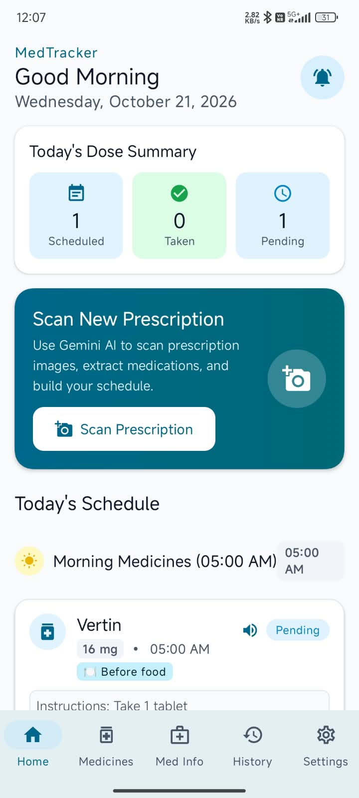
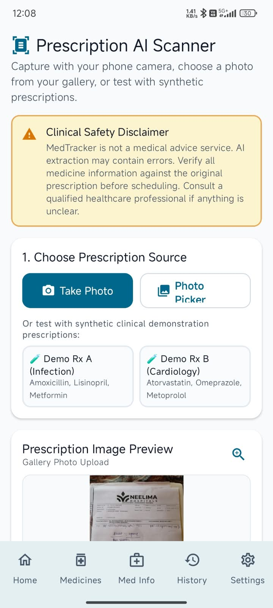
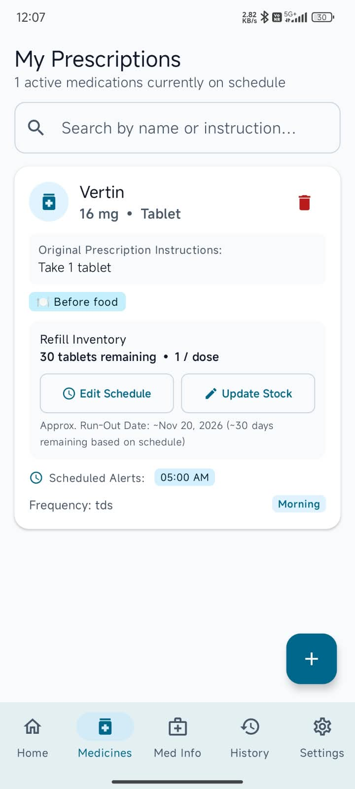
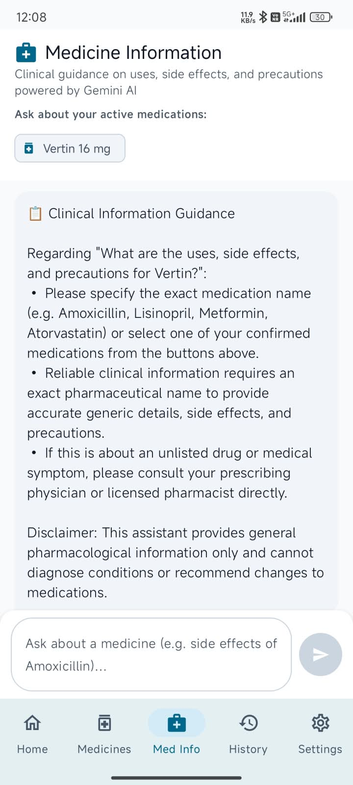
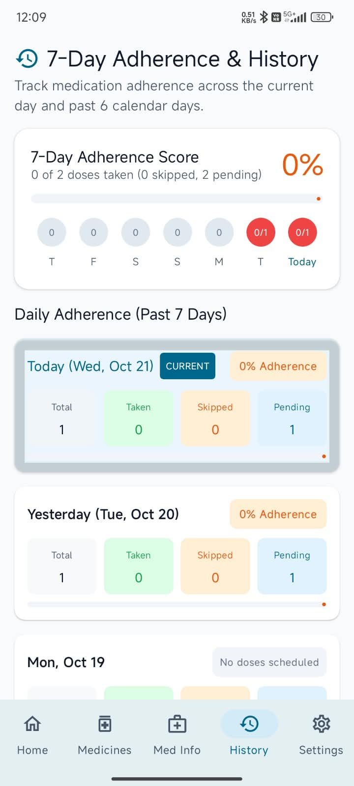

# 💊 MedTracker — Android Medication Reminder App

MedTracker is an Android application designed to help users manage their medication schedules, receive timely reminders, and track their medication adherence.

The app combines scheduled notifications, voice alerts, prescription scanning, and medicine tracking in one place.

## ✨ Features

- 💊 **Medicine Management** — Add and manage medicines and their details.
- 📸 **Prescription Scanning** — Capture or upload prescriptions for AI-assisted information extraction.
- ⏰ **Custom Reminders** — Configure reminder times for individual medicines.
- 🔊 **Voice Alerts** — Hear spoken medicine reminders.
- ⏳ **Snooze Reminders** — Snooze an alert when needed.
- ✅ **Dose Tracking** — Mark doses as Taken or Skipped, with Undo support.
- 🔄 **Refill Alerts** — Track medicine quantities and refill needs.
- 📊 **Adherence History** — Review medication activity over time.
- 🌐 **Multilingual Support** — English, Hindi, and Telugu, where implemented.
- 🤖 **AI-Powered Assistance** — Gemini API integration for supported features.

## 📱 App Screenshots

### Home Screen

### Add Prescription

### Medicine Management

### Medicine Information

### Medication History

## 🛠️ Tech Stack

- Kotlin
- Android SDK
- Jetpack Compose
- Material 3
- Android Notifications
- Android TextToSpeech
- Gemini API

## 🏗️ Project Status

MedTracker is a personal Android development project. Features and compatibility should be verified on supported Android devices.

## 🚀 Getting Started

1. Clone this repository.
2. Open the project in Android Studio.
3. Allow Gradle to sync and download the required dependencies.
4. Configure any required API credentials securely.
5. Run the application on a compatible Android device or emulator.

## 🔐 Security

- Never commit API keys, passwords, signing keys, or other secrets.
- Use a secure backend to protect Gemini API credentials in a production deployment.
- Prescription details extracted by AI should be reviewed for accuracy.

## ⚕️ Disclaimer

MedTracker is intended to help organize medication schedules. It does not replace professional medical advice or instructions from a qualified healthcare professional.

## 👨‍💻 Author

**Palash Mahawar**

[GitHub Profile](https://github.com/Palash-codr)